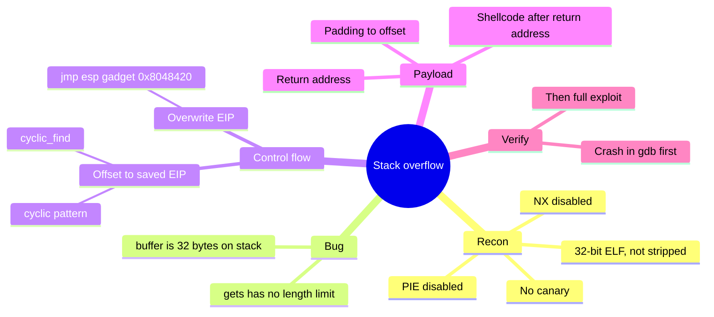

# Thought process: buffer overflow (buffer-overflow-basic)

## Questions to answer before writing the exploit

1. Where does the input land relative to the saved return address?
2. Which bytes of the payload does the program read as control data?
3. Why does the stack being executable matter here?
4. What breaks if the return address points at the shellcode directly, with no `jmp esp`?
